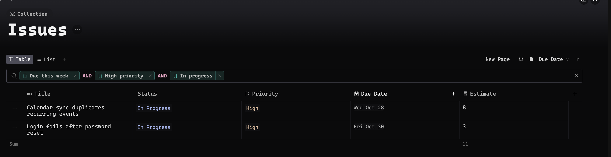
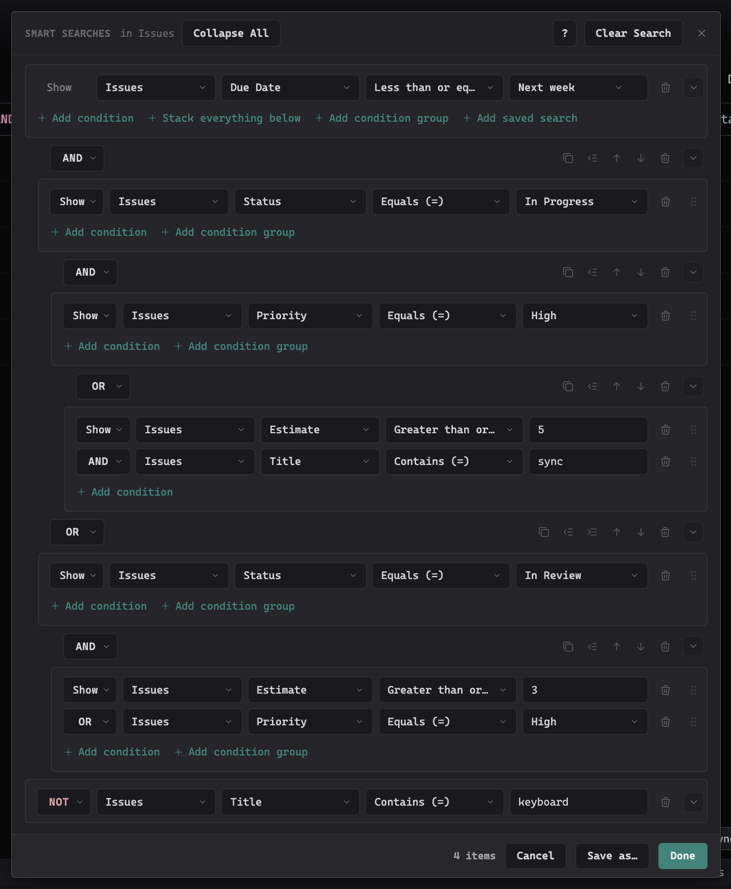
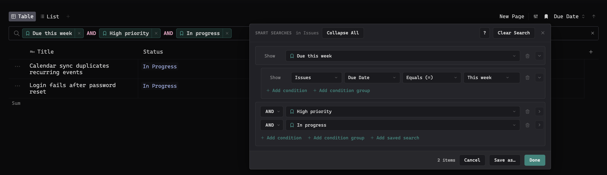
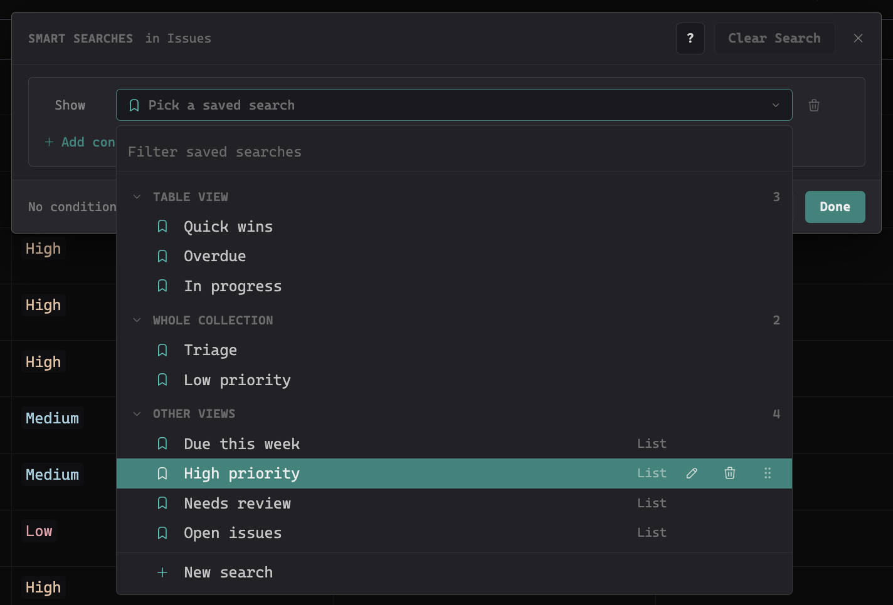
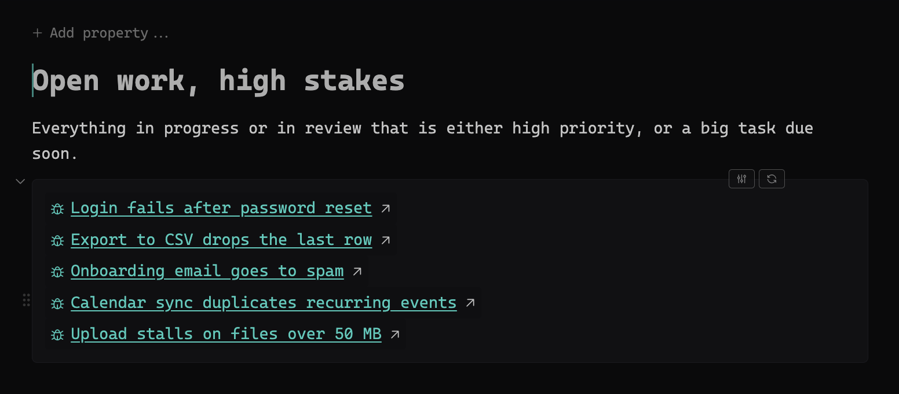
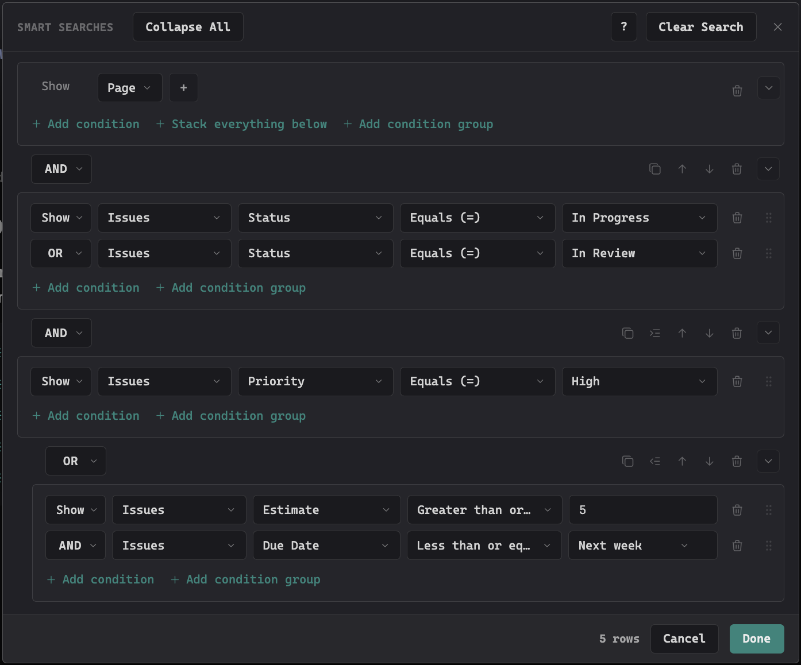

# Smart Searches

Smart Searches is a [Thymer](https://thymer.com) plugin for building, saving and reusing searches in a collection view's filter field and in Live Queries. Build a search from pickers instead of typed syntax, give it a name, and it shows up in the filter field as a chip you can combine with anything else.

## Build a search

Open any collection view. Next to the filter and sort buttons there is a **bookmark button**; it opens the builder. The bookmark is filled when the collection already has saved searches.

- **A condition** is a field, an operator and a value: Status · Equals · In Progress. Operators follow the field. A choice field lists its options, a date field offers Today, This week, Next Friday and more, a page link picks a page.
- **Join conditions** with AND (all of them), OR (any of them) or NOT (exclude). AND binds tighter than OR, the way it does in the filter field.
- **Condition groups** are for when part of a search needs the other joiner: Status is Done AND (Priority is High OR Estimate is 5 or more). A group counts as one condition, and groups can hold groups, each level indented.
- **The filter updates as you build.** Done keeps it, Cancel puts the field back the way it was, Clear Search starts over.
- Anything the builder cannot express is kept exactly as you wrote it and shown as a chip you can remove.

## Save it and use it again

- **Save**: press **Save as**, give the search a name, and choose where it shows: in this view or in the whole collection. Press Enter or **Save**.
- **Chips**: whenever the filter field holds a saved search, it shows the search's name as a chip instead of its query. Click the chip to open it in the builder, click the × to take it out of the field.
- **Combine**: in the builder, **Add saved search** adds one as a single row. Fold it out to see its conditions or change them. Saved searches mix freely with ordinary conditions and with each other.
- **Update**: when the field holds exactly one saved search, the builder offers **Update** to save your change to it, or **Save as new** to keep both.

## The library

Every saved search row opens the library: the saved searches of this collection, grouped into this view, **Whole collection** and **Other views**, with a filter at the top.

- Hover a row to **rename** it, **delete** it, or drag its grip to **reorder** it or move it to another section.
- **New search** at the bottom starts a fresh condition.

## Live Queries

A Live Query block on a page gets two buttons when you hover it: **edit in the builder** and **refresh results**. The builder works the same way there, with keywords like `@page` at the top, and writes the search back into the block.

## Dates

A date field's value menu offers relative dates (Today, This week, Next Monday, Last month and so on) and **Pick a date**, which opens a full date picker: type "next friday" or "25 aug 2026", or pick a day in the calendar. If you have [Supertask](https://github.com/parham-shafti/thymer-supertask) installed, its own date picker opens instead.

## Keyboard

- Arrow keys move between the builder's controls.
- Menus jump to the first option matching what you type.
- Select a row or a group by clicking its grip, then ⌘C / ⌘V (Ctrl+C / Ctrl+V) to copy and paste it.

## Installation

1. In Thymer, open the Command Palette (`Cmd+P` / `Ctrl+P`), run **Plugins**, and click **Create Plugin** under Global Plugins.
2. In the plugin's dialog, go to the code editor (click **Edit as Code** if you see the settings view).
3. In the **Custom Code** tab, replace the contents with [`plugin.js`](plugin.js).
4. In the **Configuration** tab, replace the contents with [`plugin.json`](plugin.json).
5. Click **Save**.

Don't enable Hot Reload. It's a development feature and can leave the plugin in a state where saved data stops persisting.

### Upgrading from Saved Searches

Replace the code in your existing Saved Searches plugin with the new [`plugin.js`](plugin.js), and in the **Configuration** tab change only `name`, `version` and `description` to the values in [`plugin.json`](plugin.json). Keep the rest of the configuration: your saved searches live in it.

## Where your saved searches live

They're stored in the plugin's own configuration, so they sync with your workspace across devices and the web client. Each workspace keeps its own. A copy is also kept in the browser's local storage as a safety net, and the newer of the two wins on load.

Writing the configuration reloads the plugin, which would clear whatever is typed in the filter field, so the plugin waits to write until the builder is closed and the field is empty. Your saved searches are never lost, and a search in progress is never wiped out from under you.

## How it works

- The filter field is a plain `<input>` in Thymer's page. Running a search sets its value and fires the same `input` event typing would, so Thymer runs the search normally. The chips are a layer drawn over the field while it isn't focused.
- The builder reads the text in the field, turns it into rows, and writes the text back as you change them. A search that reads back the same is written back unchanged.
- Thymer sometimes builds a filter's collection list while that list is still loading, and the field then rejects every query with `No collection "X"`. Smart Searches notices and rebuilds the list, so the filter keeps working.

## License

[MIT](LICENSE)
